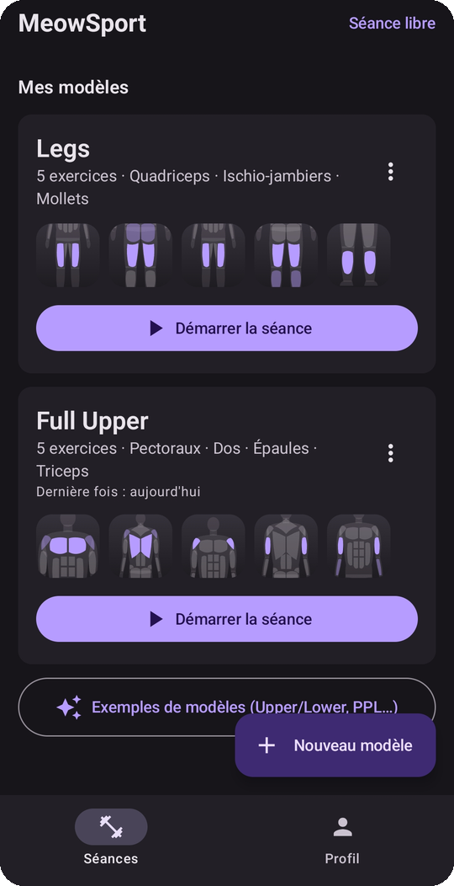
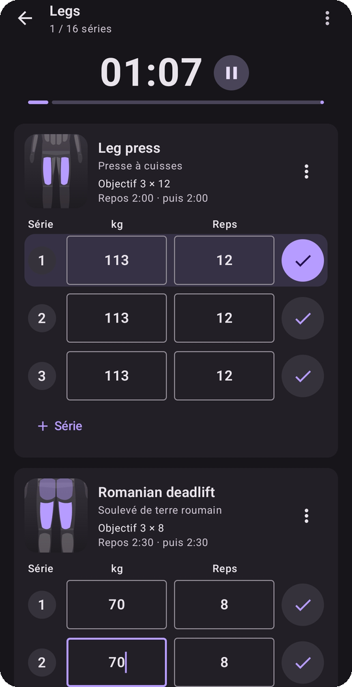
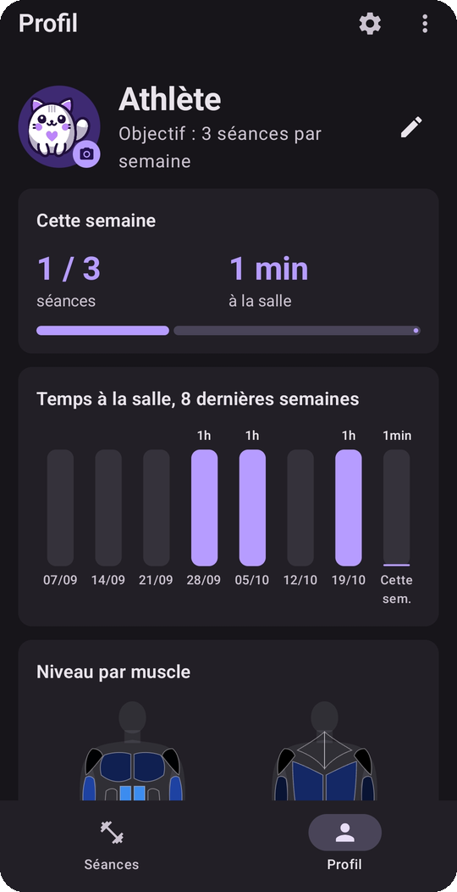
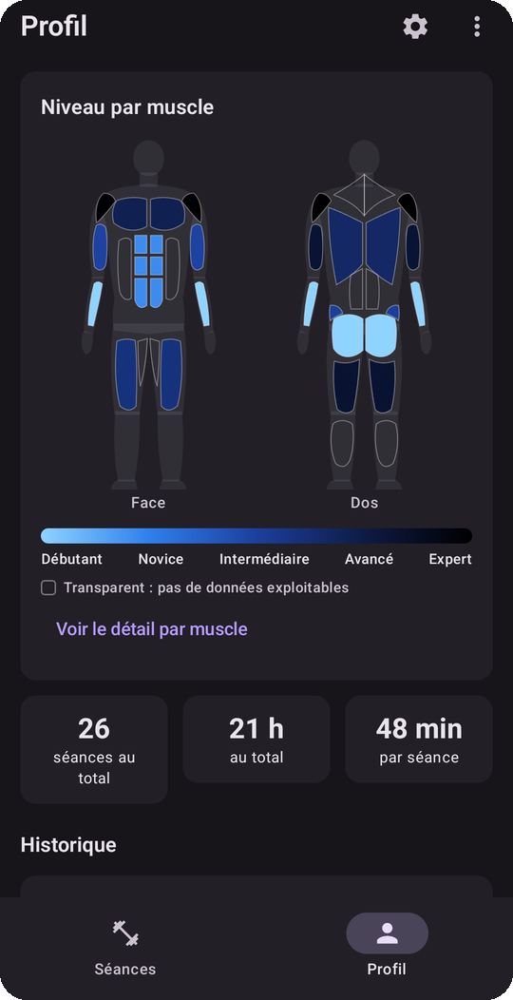
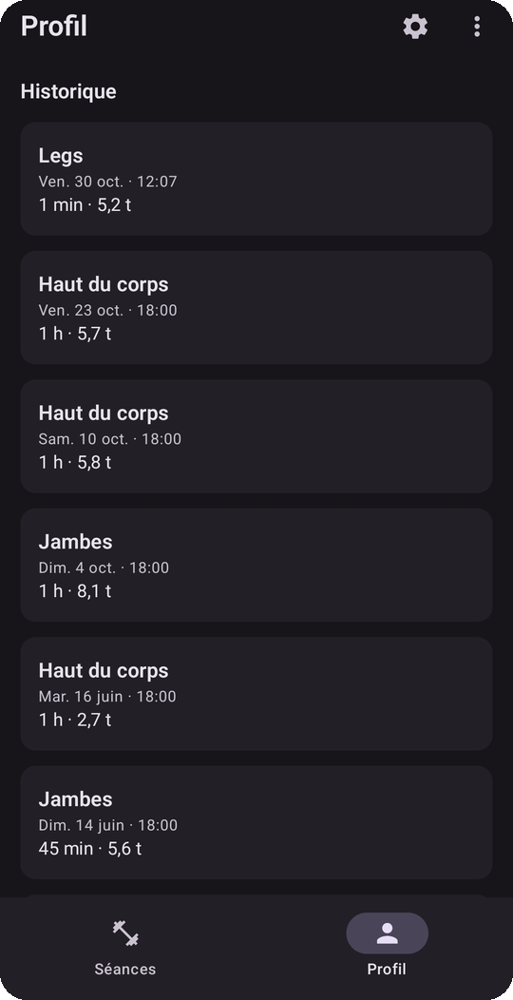

<h1 align="center">MeowSport 🐱💪</h1>

  <b>Ton carnet de muscu, en mieux.</b> 
  Prépare tes séances, suis chaque série en direct et regarde tes muscles progresser. 
  100 % hors ligne, sans compte, sans pub.

  <a href="https://github.com/ne0re0/meowsport/releases/latest"><b>📥 Télécharger l'APK</b></a>

  
  
  
  
  

---

## Pourquoi MeowSport ?

- **Zéro friction à la salle.** Tu lances ta séance, tu coches tes séries, le repos démarre tout seul. Pas besoin de rouvrir l'appli : tout se pilote depuis la notification.
- **Tu vois tes progrès.** Chaque fois que tu bats ton record (plus lourd, plus de reps ou plus de volume), MeowSport te félicite et met ton programme à jour.
- **Tu sais où tu en es.** Une carte du corps te montre ton niveau muscle par muscle, de débutant à expert.
- **Tes données restent chez toi.** Aucun compte, aucun serveur. Un export JSON suffit pour tout transférer sur un nouveau téléphone.

## 🏋️ Prépare tes séances

Crée tes **modèles de séance** (Legs, Full Upper, PPL…) à partir d'un catalogue de **plus de 150 exercices**, avec recherche en français ou en anglais et filtre par muscle. Tu peux aussi créer tes propres exercices.

Pour chaque exercice, tu règles le poids (avec option « par main »), les séries, les répétitions, le repos entre les séries et le repos avant l'exercice suivant.

Chaque exercice a sa petite illustration avec le muscle travaillé en violet. Tous les dessins sont faits maison.

Pas d'inspiration ? Pars d'un **exemple de programme** (Upper/Lower, PPL…) ou lance une **séance libre**.

## ⏱️ Suis ta séance en direct

Un chrono global, des séries à cocher, des poids et des répétitions modifiables à la volée.

Dès que tu valides une série, le **minuteur de récupération** démarre. Trois bips à 2 s, 1 s et 0 s te préviennent, le dernier plus fort, et le son des autres applis baisse le temps du bip.

Pendant toute la séance, une **notification** affiche le chrono et le repos en cours, avec Pause / Reprendre et « Terminer et sauvegarder ». L'écran reste allumé si tu le souhaites.

Tu peux laisser une note pour la prochaine fois, sur la séance ou sur chaque exercice.

## 📈 Mesure ta progression

- **Objectif de la semaine** : nombre de séances et temps passé à la salle, avec un graphique sur 8 semaines.
- **Niveau par muscle** : une carte du corps, face et dos, colorée du bleu clair (débutant) au noir (expert). Le niveau vient de ta meilleure série sur chaque exercice : 1RM estimé (formule d'Epley), rapporté à ton poids de corps et comparé à des standards de force.
- **Historique détaillé** de toutes tes séances, avec la durée et le tonnage soulevé.
- **Fin de séance intelligente** : ton modèle se met à jour avec ce que tu as vraiment fait, pour viser plus haut la fois suivante.

## ⚙️ Et aussi

- **Thème** clair, sombre ou système, et couleur principale au choix (violet par défaut).
- **Photo de profil** : touche l'avatar pour choisir une photo.
- **Réglages** complets : valeurs par défaut des nouveaux exercices, repos automatique, volume des bips, vibration, félicitations, début de semaine…
- **Import / export** (menu ⋮ du Profil) : sauvegarde tes modèles et ton historique dans un fichier JSON. Réimporter le même fichier n'ajoute pas de doublons.
- **Mises à jour automatiques** : au lancement, l'appli te propose la nouvelle version si elle existe (Plus tard / Ignorer cette version). Rien ne s'affiche si GitHub est injoignable.

## 📥 Installation

1. Ouvre la page [**Releases**](https://github.com/ne0re0/meowsport/releases/latest) depuis ton téléphone Android (8.0 ou plus).
2. Télécharge `MeowSport.apk`.
3. Autorise l'installation depuis ton navigateur, puis installe.

Toutes les versions sont signées avec la même clé : une mise à jour s'installe par-dessus l'ancienne sans perdre tes données.

## 🛠️ Technique

Kotlin, Jetpack Compose (Material 3), Room. minSdk 26 (Android 8.0).

Chaque push sur `main` compile l'APK et le publie dans les Releases.
Pour compiler en local : `./gradlew assembleRelease` (il faut le SDK Android).
